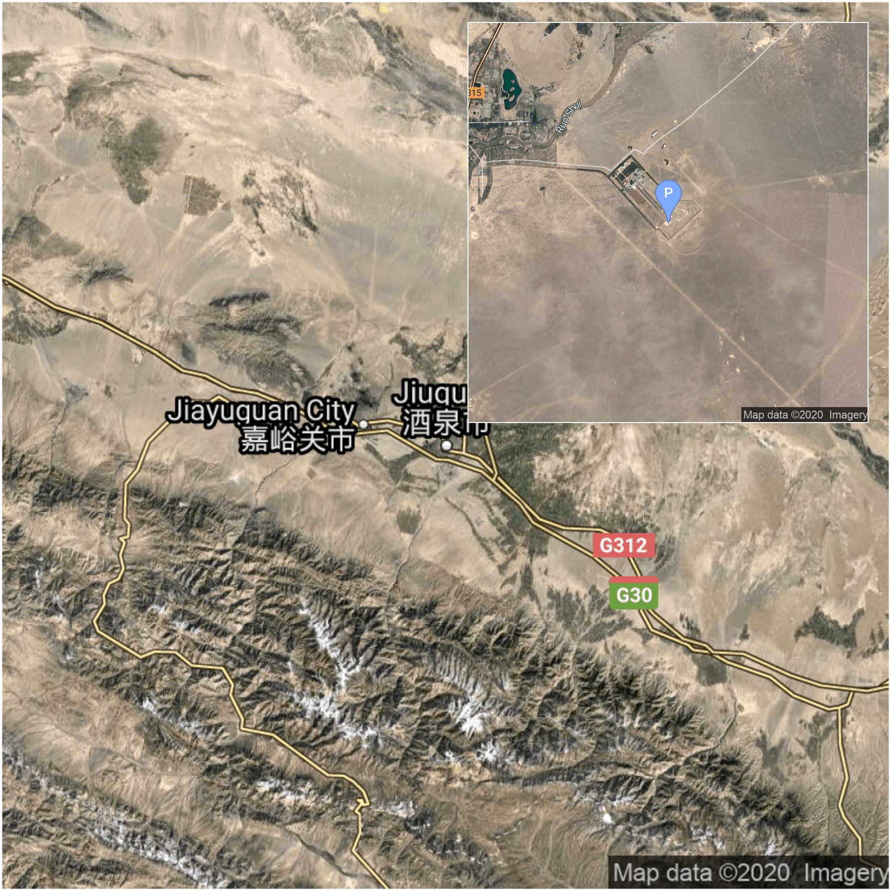

## About us 🧑‍🚀
The Space Devs is a group of space enthusiast developers working on a range of
services, united in a common goal to improve public knowledge and accessibility
of spaceflight information. We aim to bring space app developers together into a
thriving community by providing helpful data and tools, accessible to everyone
for free.

## API Showcase - Launch Library 2 🚀

### Next Launch ⌛
The next space launch, retrieved from our
<a href="https://thespacedevs.com/llapi">Launch Library 2 API</a>, is
**Falcon 9 Block 5 | USSF-317**. It is scheduled to be launched by *SpaceX*

from *<a href="https://en.wikipedia.org/wiki/Vandenberg_Space_Launch_Complex_4#SLC-4E">Space Launch Complex 4E</a>, Vandenberg SFB, CA, USA*

at <a href="https://www.timeanddate.com/worldclock/fixedtime.html?iso=20261120T024600">2026-11-20 02:46:00 UTC</a>.  Until
then, this pad will have been used for 308
out of 924 launches from this location. The launch status is currently
*Go* 🟩 . The mission type is
*Government/Top Secret* and the payload will be injected
into *a Low Earth Orbit
(LEO)*.
 
<blockquote>
  A classified mission for the United States Space Force. It is possibly a batch of classified LEO satellites based on SpaceX’s Starshield satellite bus, based on locations of rocket stage drop zones being exact fits with previous Starlink Group 15 launches.
</blockquote>

  
  

### Within a month's time 📅
- \[<a href="https://www.timeanddate.com/worldclock/fixedtime.html?iso=20261120T024600">2026-11-20 02:46:00 UTC</a>\]   🟩   **Falcon 9 Block 5 | USSF-317** from Vandenberg SFB, CA, USA.
- \[<a href="https://www.timeanddate.com/worldclock/fixedtime.html?iso=20261120T115100">2026-11-20 11:51:00 UTC</a>\]   🟩   **Long March 8A | SatNet LEO Group TBD?** from Wenchang Space Launch Site, People's Republic of China.
- \[<a href="https://www.timeanddate.com/worldclock/fixedtime.html?iso=20261121T034600">2026-11-21 03:46:00 UTC</a>\]   🟩   **Long March 6C | Unknown Payload** from Taiyuan Satellite Launch Center, People's Republic of China.
- \[<a href="https://www.timeanddate.com/worldclock/fixedtime.html?iso=20261121T123000">2026-11-21 12:30:00 UTC</a>\]   🟩   **Falcon 9 Block 5 | NROL-136** from Vandenberg SFB, CA, USA.
- \[<a href="https://www.timeanddate.com/worldclock/fixedtime.html?iso=20261123T110900">2026-11-23 11:09:00 UTC</a>\]   🟩   **Ariane 64 Block 2 | Amazon Leo (LE-04)** from Guiana Space Centre, French Guiana.
- \[<a href="https://www.timeanddate.com/worldclock/fixedtime.html?iso=20261123T160400">2026-11-23 16:04:00 UTC</a>\]   🟩   **Falcon 9 Block 5 | USSF-266** from Vandenberg SFB, CA, USA.
- \[<a href="https://www.timeanddate.com/worldclock/fixedtime.html?iso=20261124T050300">2026-11-24 05:03:00 UTC</a>\]   🟨   **Soyuz 2.1b | Progress MS-36 (97P)** from Baikonur Cosmodrome, Republic of Kazakhstan.
- \[<a href="https://www.timeanddate.com/worldclock/fixedtime.html?iso=20261124T070000">2026-11-24 07:00:00 UTC</a>\]   🟨   **Long March 12 | SatNet LEO Group TBD?** from Wenchang Space Launch Site, People's Republic of China.
- \[<a href="https://www.timeanddate.com/worldclock/fixedtime.html?iso=20261125T000000">2026-11-25 00:00:00 UTC</a>\]   🟧   **Long March 2F/G | Shenzhou 24** from Jiuquan Satellite Launch Center, People's Republic of China.
- \[<a href="https://www.timeanddate.com/worldclock/fixedtime.html?iso=20261126T200000">2026-11-26 20:00:00 UTC</a>\]   🟨   **Spectrum | AT-Astra and Others (Spectrum Flight 3)** from Andøya Spaceport.

### Launch Statuses 🟩🟨🟧

    <table class="tg">
    <thead>
      <tr>
        <th class="tg-0pky">Symbol</th>
        <th class="tg-0pky">Meaning</th>
        <th class="tg-0pky">Description</th>
      </tr>
    </thead>
    <tbody>
      <tr>
        <td class="tg-0pky">🟩</td>
        <td class="tg-0pky">Go For Launch (Go)</td>
        <td class="tg-0pky">Current T-0 confirmed by official or reliable sources.</td>
      </tr>
      <tr>
        <td class="tg-0pky">🟨</td>
        <td class="tg-0pky">To Be Confirmed (TBC)</td>
        <td class="tg-0pky">Awaiting official confirmation - current date is known with some certainty.</td>
      </tr>
      <tr>
        <td class="tg-0pky">🟧</td>
        <td class="tg-0pky">To Be Determined (TBD)</td>
        <td class="tg-0pky">Current date is a placeholder or rough estimation based on unreliable or interpreted sources.</td>
      </tr>
    </tbody>
    </table>

## API Showcase - Spaceflight News API 📰

### Latest News ⌛
- <a href="https://europeanspaceflight.com/esa-awards-ohb-e102m-contract-for-clearspace-1-debris-removal-mission/" >🔗</a> **[European Spaceflight]** ESA Awards OHB €102M Contract for ClearSpace-1 Debris Removal Mission
- <a href="https://science.nasa.gov/image-article/apod-2026-november-19-the-horsehead-and-flame-nebulas/" >🔗</a> **[NASA]** APOD: 2026 November 19 – The Horsehead and Flame Nebulas
- <a href="https://science.nasa.gov/earth/earth-observatory/el-nino-rains-paint-the-atacama/" >🔗</a> **[NASA]** El Niño Rains Paint the Atacama
- <a href="https://spacepolicyonline.com/news/voyager-1-reaches-new-milestone-one-light-day-from-earth/" >🔗</a> **[SpacePolicyOnline.com]** Voyager 1 Reaches New Milestone: One Light-Day from Earth
- <a href="https://spacepolicyonline.com/news/nasa-and-fcc-nominations-advance-out-of-committee-despite-democratic-boycott/" >🔗</a> **[SpacePolicyOnline.com]** NASA and FCC Nominations Advance Out of Committee Despite Democratic Boycott
- <a href="https://www.nasa.gov/news-release/nasa-sets-coverage-for-northrop-grumman-crs-25-launch-prelaunch/" >🔗</a> **[NASA]** NASA Sets Coverage for Northrop Grumman CRS-25 Launch, Prelaunch
- <a href="https://spacenews.com/flexell-space-and-alatyr-sign-mou-to-explore-solar-power-solutions-for-orbital-data-centers/" >🔗</a> **[SpaceNews]** Flexell Space and ALATYR Sign MoU to Explore Solar Power Solutions for Orbital Data Centers
- <a href="https://www.nasaspaceflight.com/2026/11/voyager-1-light-day/" >🔗</a> **[NASASpaceflight]** Voyager 1 reaches one light-day nearly 50 years after launch
- <a href="https://spaceflightnow.com/2026/11/18/vulcan-failure-investigation-focuses-on-inadequate-fuel-supply-to-booster-engines/" >🔗</a> **[Spaceflight Now]** Vulcan failure investigation focuses on ‘inadequate fuel supply’ to booster engines
- <a href="https://spacenews.com/all-points-logistics-announces-partnership-with-expeditors-for-space-prep-logistics-center-at-kennedy-space-center/" >🔗</a> **[SpaceNews]** All Points Logistics Announces Partnership with Expeditors for Space Prep Logistics Center at Kennedy Space Center

### Launch-related News 🚀

- <a href="https://www.nasaspaceflight.com/2026/11/launch-preview-111626/" >🔗</a> **[NASASpaceflight]** Launch Preview: Ariane 6 to launch Amazon satellites, Falcon 9 to launch government missions
- <a href="https://www.nasaspaceflight.com/2026/11/launch-preview-11092026/" >🔗</a> **[NASASpaceflight]** Launch Preview: Starship, Vulcan, and Electron launches scheduled for busy week

  

  This <code>README.md</code> was last auto generated at <a href="https://www.timeanddate.com/worldclock/fixedtime.html?iso=20261119T073056">2026-11-19 07:30:56 UTC</a>
   
  <!-- <a href="https://medium.com/@g.h.garrett" target="_blank">Learn to add space launches to your profile here!</a> -->

