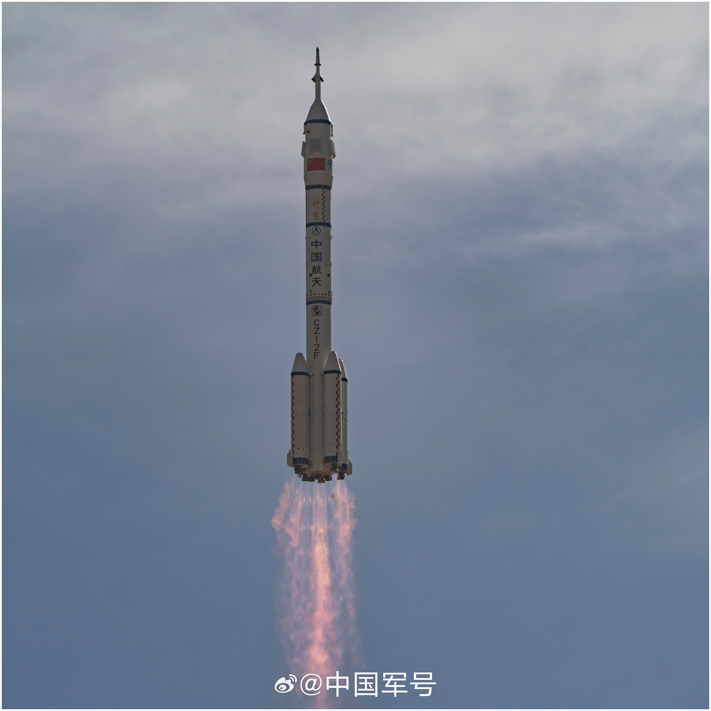

## About us 🧑‍🚀
The Space Devs is a group of space enthusiast developers working on a range of
services, united in a common goal to improve public knowledge and accessibility
of spaceflight information. We aim to bring space app developers together into a
thriving community by providing helpful data and tools, accessible to everyone
for free.

## API Showcase - Launch Library 2 🚀

### Next Launch ⌛
The next space launch, retrieved from our
<a href="https://thespacedevs.com/llapi">Launch Library 2 API</a>, is
**Soyuz 2.1b | Progress MS-36 (97P)**. It is scheduled to be launched by *Russian Federal Space Agency (ROSCOSMOS)*

from *<a href="https://en.wikipedia.org/wiki/Baikonur_Cosmodrome_Site_31">31/6</a>, Baikonur Cosmodrome, Republic of Kazakhstan*

at <a href="https://www.timeanddate.com/worldclock/fixedtime.html?iso=20261124T101300">2026-11-24 10:13:00 UTC</a>.  Until
then, this pad will have been used for 430
out of 1565 launches from this location. The launch status is currently
*TBC* 🟨 . The mission type is
*Resupply* and the payload will be injected
into *a Low Earth Orbit
(LEO)*.
 
<blockquote>
  Progress resupply mission to the International Space Station.
</blockquote>

  
  

### Within a month's time 📅
- \[<a href="https://www.timeanddate.com/worldclock/fixedtime.html?iso=20261124T101300">2026-11-24 10:13:00 UTC</a>\]   🟨   **Soyuz 2.1b | Progress MS-36 (97P)** from Baikonur Cosmodrome, Republic of Kazakhstan.
- \[<a href="https://www.timeanddate.com/worldclock/fixedtime.html?iso=20261124T104500">2026-11-24 10:45:00 UTC</a>\]   🟩   **Ariane 64 Block 2 | Amazon Leo (LE-04)** from Guiana Space Centre, French Guiana.
- \[<a href="https://www.timeanddate.com/worldclock/fixedtime.html?iso=20261124T155500">2026-11-24 15:55:00 UTC</a>\]   🟩   **Falcon 9 Block 5 | USSF-266** from Vandenberg SFB, CA, USA.
- \[<a href="https://www.timeanddate.com/worldclock/fixedtime.html?iso=20261125T000800">2026-11-25 00:08:00 UTC</a>\]   🟩   **Long March 2F/G | Shenzhou 24** from Jiuquan Satellite Launch Center, People's Republic of China.
- \[<a href="https://www.timeanddate.com/worldclock/fixedtime.html?iso=20261126T093000">2026-11-26 09:30:00 UTC</a>\]   🟩   **Long March 2D | Unknown Payload** from Xichang Satellite Launch Center, People's Republic of China.
- \[<a href="https://www.timeanddate.com/worldclock/fixedtime.html?iso=20261127T000000">2026-11-27 00:00:00 UTC</a>\]   🟩   **Electron | Night Owls Never Sleep (StriX Launch 14)** from Rocket Lab Launch Complex 1, Mahia Peninsula, New Zealand.
- \[<a href="https://www.timeanddate.com/worldclock/fixedtime.html?iso=20261127T125300">2026-11-27 12:53:00 UTC</a>\]   🟩   **Long March 6A | Unknown Payload** from Taiyuan Satellite Launch Center, People's Republic of China.
- \[<a href="https://www.timeanddate.com/worldclock/fixedtime.html?iso=20261129T034600">2026-11-29 03:46:00 UTC</a>\]   🟩   **Long March 6C | Unknown Payload** from Taiyuan Satellite Launch Center, People's Republic of China.
- \[<a href="https://www.timeanddate.com/worldclock/fixedtime.html?iso=20261129T043900">2026-11-29 04:39:00 UTC</a>\]   🟩   **Falcon 9 Block 5 | USSF-380** from Vandenberg SFB, CA, USA.
- \[<a href="https://www.timeanddate.com/worldclock/fixedtime.html?iso=20261129T155000">2026-11-29 15:50:00 UTC</a>\]   🟩   **Falcon 9 Block 5 | Cygnus CRS-2 NG-25** from Cape Canaveral SFS, FL, USA.

### Launch Statuses 🟩🟨🟧

    <table class="tg">
    <thead>
      <tr>
        <th class="tg-0pky">Symbol</th>
        <th class="tg-0pky">Meaning</th>
        <th class="tg-0pky">Description</th>
      </tr>
    </thead>
    <tbody>
      <tr>
        <td class="tg-0pky">🟩</td>
        <td class="tg-0pky">Go For Launch (Go)</td>
        <td class="tg-0pky">Current T-0 confirmed by official or reliable sources.</td>
      </tr>
      <tr>
        <td class="tg-0pky">🟨</td>
        <td class="tg-0pky">To Be Confirmed (TBC)</td>
        <td class="tg-0pky">Awaiting official confirmation - current date is known with some certainty.</td>
      </tr>
      <tr>
        <td class="tg-0pky">🟧</td>
        <td class="tg-0pky">To Be Determined (TBD)</td>
        <td class="tg-0pky">Current date is a placeholder or rough estimation based on unreliable or interpreted sources.</td>
      </tr>
    </tbody>
    </table>

## API Showcase - Spaceflight News API 📰

### Latest News ⌛
- <a href="https://www.nasa.gov/missions/europa-clipper/nasa-documentary-captures-europa-clippers-journey-into-deep-space/" >🔗</a> **[NASA]** NASA+ Documentary Captures Europa Clipper’s Journey Into Deep Space
- <a href="https://europeanspaceflight.com/eutelsat-wins-60-million-us-space-force-contract/" >🔗</a> **[European Spaceflight]** Eutelsat Wins $60 Million US Space Force Contract
- <a href="https://science.nasa.gov/missions/webb/nasas-webb-shows-how-supernova-dust-chronicles-star-evolution/" >🔗</a> **[NASA]** NASA’s Webb Shows How Supernova Dust Chronicles Star Evolution
- <a href="https://science.nasa.gov/image-article/apod-2026-november-23-the-emergence-of-dark-nebula-lynds-1251/" >🔗</a> **[NASA]** APOD: 2026 November 23 – The Emergence of Dark Nebula Lynds 1251
- <a href="https://science.nasa.gov/earth/earth-observatory/laser-focus-at-the-top-of-the-world/" >🔗</a> **[NASA]** Laser Focus at the Top of the World
- <a href="https://www.nasaspaceflight.com/2026/11/china-roundup-2026-11/" >🔗</a> **[NASASpaceflight]** China details its path to a crewed Moon landing before 2030
- <a href="https://spacepolicyonline.com/news/whats-happening-in-space-policy-november-22-29-2026/" >🔗</a> **[SpacePolicyOnline.com]** What’s Happening in Space Policy November 22-29, 2026
- <a href="https://www.nasa.gov/centers-and-facilities/johnson/65-years-of-human-spaceflight-at-nasa-johnson/" >🔗</a> **[NASA]** 65 Years of Human Spaceflight at NASA Johnson
- <a href="https://science.nasa.gov/image-article/apod-2026-november-22-swirls-and-colors-on-jupiter-from-juno/" >🔗</a> **[NASA]** APOD: 2026 November 22 – Swirls and Colors on Jupiter from Juno
- <a href="https://spaceflightnow.com/2026/11/21/live-coverage-spacex-to-launch-intelligence-gathering-satellites-for-the-national-reconnaissance-office-3/" >🔗</a> **[Spaceflight Now]** Live coverage: SpaceX to launch intelligence-gathering satellites for the National Reconnaissance Office

### Launch-related News 🚀

  

  This <code>README.md</code> was last auto generated at <a href="https://www.timeanddate.com/worldclock/fixedtime.html?iso=20261123T163056">2026-11-23 16:30:56 UTC</a>
   
  <!-- <a href="https://medium.com/@g.h.garrett" target="_blank">Learn to add space launches to your profile here!</a> -->

