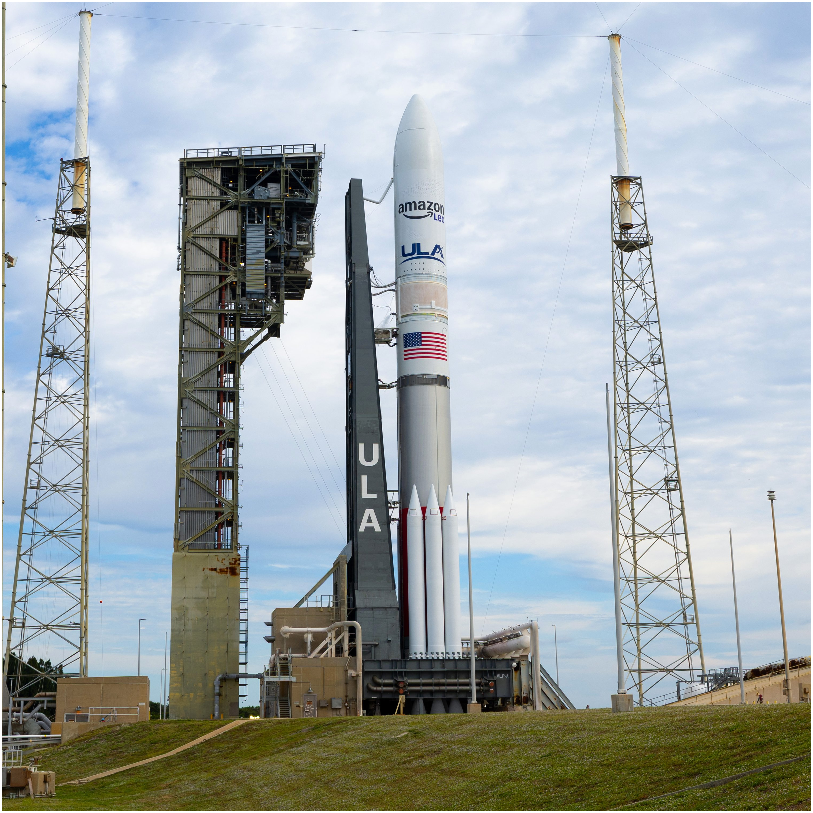
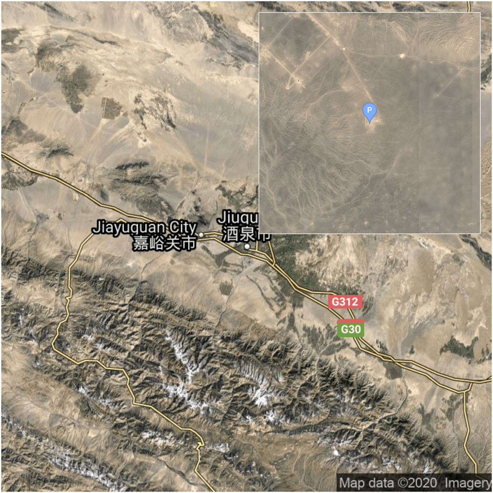

## About us 🧑‍🚀
The Space Devs is a group of space enthusiast developers working on a range of
services, united in a common goal to improve public knowledge and accessibility
of spaceflight information. We aim to bring space app developers together into a
thriving community by providing helpful data and tools, accessible to everyone
for free.

## API Showcase - Launch Library 2 🚀

### Next Launch ⌛
The next space launch, retrieved from our
<a href="https://thespacedevs.com/llapi">Launch Library 2 API</a>, is
**Long March 2C | Unknown Payload**. It is scheduled to be launched by *China Aerospace Science and Technology Corporation*

from *<a href="https://en.wikipedia.org/wiki/Xichang_Satellite_Launch_Center">Launch Complex 3 (LC-3/LA-1)</a>, Xichang Satellite Launch Center, People's Republic of China*

at <a href="https://www.timeanddate.com/worldclock/fixedtime.html?iso=20261105T155200">2026-11-05 15:52:00 UTC</a>.  Until
then, this pad will have been used for 108
out of 242 launches from this location. The launch status is currently
*Go* 🟩 . The mission type is
*Unknown* and the payload will be injected
into *an Unknown
(N/A)*.
 
<blockquote>
  Details TBD.
</blockquote>

  
  

### Within a month's time 📅
- \[<a href="https://www.timeanddate.com/worldclock/fixedtime.html?iso=20261105T155200">2026-11-05 15:52:00 UTC</a>\]   🟩   **Long March 2C | Unknown Payload** from Xichang Satellite Launch Center, People's Republic of China.
- \[<a href="https://www.timeanddate.com/worldclock/fixedtime.html?iso=20261106T232800">2026-11-06 23:28:00 UTC</a>\]   🟩   **Ceres-2 | Unknown Payload** from Jiuquan Satellite Launch Center, People's Republic of China.
- \[<a href="https://www.timeanddate.com/worldclock/fixedtime.html?iso=20261107T004600">2026-11-07 00:46:00 UTC</a>\]   🟩   **Falcon 9 Block 5 | USSF-432** from Vandenberg SFB, CA, USA.
- \[<a href="https://www.timeanddate.com/worldclock/fixedtime.html?iso=20261108T201700">2026-11-08 20:17:00 UTC</a>\]   🟩   **Long March 12 | SatNet LEO Group TBD?** from Wenchang Space Launch Site, People's Republic of China.
- \[<a href="https://www.timeanddate.com/worldclock/fixedtime.html?iso=20261110T030300">2026-11-10 03:03:00 UTC</a>\]   🟩   **Falcon 9 Block 5 | USSF-627** from Vandenberg SFB, CA, USA.
- \[<a href="https://www.timeanddate.com/worldclock/fixedtime.html?iso=20261113T042300">2026-11-13 04:23:00 UTC</a>\]   🟩   **Falcon 9 Block 5 | USSF-317** from Vandenberg SFB, CA, USA.
- \[<a href="https://www.timeanddate.com/worldclock/fixedtime.html?iso=20261113T175400">2026-11-13 17:54:00 UTC</a>\]   🟩   **Vulcan VC6L | Amazon Leo (LV-01)** from Cape Canaveral SFS, FL, USA.
- \[<a href="https://www.timeanddate.com/worldclock/fixedtime.html?iso=20261114T000000">2026-11-14 00:00:00 UTC</a>\]   🟧   **Electron | The Mountain God Rises (iQPS Launch 10)** from Rocket Lab Launch Complex 1, Mahia Peninsula, New Zealand.
- \[<a href="https://www.timeanddate.com/worldclock/fixedtime.html?iso=20261120T110000">2026-11-20 11:00:00 UTC</a>\]   🟨   **Long March 8A | SatNet LEO Group TBD?** from Wenchang Space Launch Site, People's Republic of China.
- \[<a href="https://www.timeanddate.com/worldclock/fixedtime.html?iso=20261123T000000">2026-11-23 00:00:00 UTC</a>\]   🟧   **Ariane 64 Block 2 | Amazon Leo (LE-04)** from Guiana Space Centre, French Guiana.

### Launch Statuses 🟩🟨🟧

    <table class="tg">
    <thead>
      <tr>
        <th class="tg-0pky">Symbol</th>
        <th class="tg-0pky">Meaning</th>
        <th class="tg-0pky">Description</th>
      </tr>
    </thead>
    <tbody>
      <tr>
        <td class="tg-0pky">🟩</td>
        <td class="tg-0pky">Go For Launch (Go)</td>
        <td class="tg-0pky">Current T-0 confirmed by official or reliable sources.</td>
      </tr>
      <tr>
        <td class="tg-0pky">🟨</td>
        <td class="tg-0pky">To Be Confirmed (TBC)</td>
        <td class="tg-0pky">Awaiting official confirmation - current date is known with some certainty.</td>
      </tr>
      <tr>
        <td class="tg-0pky">🟧</td>
        <td class="tg-0pky">To Be Determined (TBD)</td>
        <td class="tg-0pky">Current date is a placeholder or rough estimation based on unreliable or interpreted sources.</td>
      </tr>
    </tbody>
    </table>

## API Showcase - Spaceflight News API 📰

### Latest News ⌛
- <a href="https://europeanspaceflight.com/pld-space-completes-miura-5-flight-termination-system-test/" >🔗</a> **[European Spaceflight]** PLD Space Completes MIURA 5 Flight Termination System Test
- <a href="https://www.esa.int/Applications/Observing_the_Earth/Meteorological_missions/MetOp_Second_Generation/Time_to_wake_up_MetOp-SG-B1_weather_satellite" >🔗</a> **[ESA]** Time to wake up MetOp-SG-B1 weather satellite
- <a href="https://science.nasa.gov/image-article/apod-2026-november-4-the-not-so-hidden-galaxy-ic-342/" >🔗</a> **[NASA]** APOD: 2026 November 4 – The Not-So-Hidden Galaxy, IC 342
- <a href="https://science.nasa.gov/earth/earth-observatory/before-the-dawn-in-americas-heartland/" >🔗</a> **[NASA]** Before the Dawn in America’s Heartland
- <a href="https://spacenews.com/simera-sense-and-spacemanic-to-collaborate-on-a-new-complete-dual-use-mission-solution/" >🔗</a> **[SpaceNews]** Simera Sense and Spacemanic to Collaborate on a New Complete Dual-Use Mission Solution
- <a href="https://arstechnica.com/space/2026/11/this-space-company-is-betting-its-future-on-a-propellant-available-everywhere/" >🔗</a> **[Arstechnica]** This space company is betting its future on a propellant available everywhere
- <a href="https://www.nasa.gov/image-article/astronaut-and-earth/" >🔗</a> **[NASA]** Astronaut and Earth
- <a href="https://www.nasa.gov/centers-and-facilities/nesc/tb-26-10-printed-circuit-board-assembly-chip-resistor-body-cracking/" >🔗</a> **[NASA]** TB 26-10 Printed Circuit Board Assembly Chip Resistor Body Cracking
- <a href="https://europeanspaceflight.com/swiss-startup-plans-lunar-lander-powered-by-rotating-detonation-engine/" >🔗</a> **[European Spaceflight]** Swiss Startup Plans Lunar Lander Powered by Rotating Detonation Engine
- <a href="https://www.nasa.gov/learning-resources/nasa-astronaut-stem-creator-connect-with-students-for-stem-day/" >🔗</a> **[NASA]** NASA Astronaut, STEM Creator Connect with Students for STEM Day

### Launch-related News 🚀

- <a href="https://www.nasaspaceflight.com/2026/11/launch-preview-110226/" >🔗</a> **[NASASpaceflight]** Launch Preview: Falcon 9 to launch USSF missions, China to launch internet satellites

  

  This <code>README.md</code> was last auto generated at <a href="https://www.timeanddate.com/worldclock/fixedtime.html?iso=20261104T120237">2026-11-04 12:02:37 UTC</a>
   
  <!-- <a href="https://medium.com/@g.h.garrett" target="_blank">Learn to add space launches to your profile here!</a> -->

